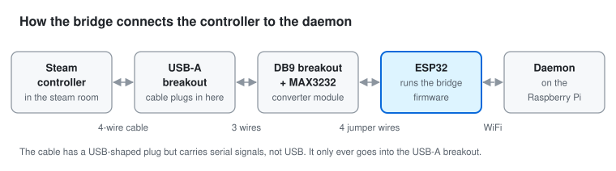
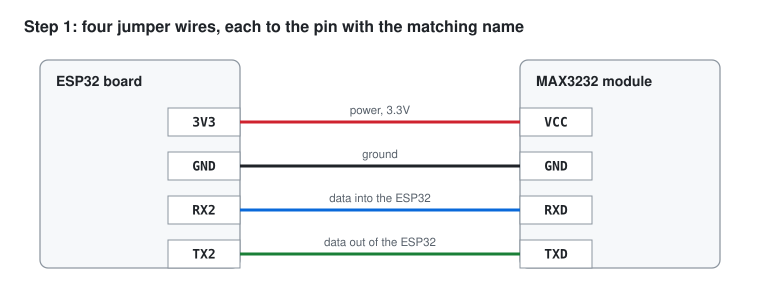
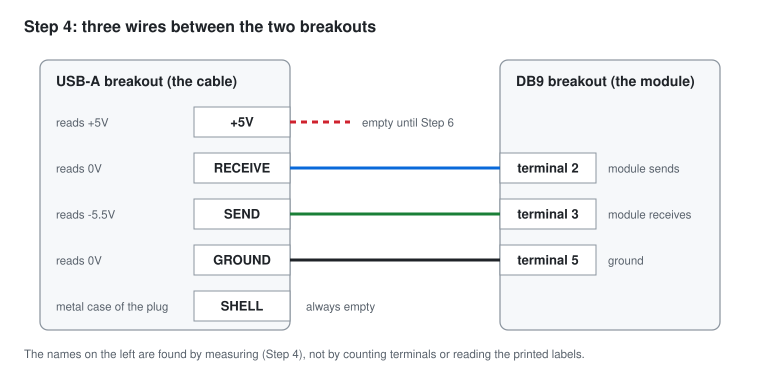

# Building the TOLO steam bridge

The bridge is a small WiFi board that lets the daemon talk to the steam room's controller. It replaces the TOLO App Box, which died from water damage in November 2026.

The controller has a serial port on a 4-wire cable. The bridge plugs into that cable, joins WiFi, and passes commands from the daemon to the controller and the answers back. It only obeys commands signed with a secret key that it shares with the daemon.

The build takes about two hours. It needs a screwdriver and a multimeter. There is no soldering if the ESP32 board arrives with its pins already attached.



## Four rules before you touch anything

1. **The cable's plug looks like USB but is not USB.** Never plug it into a laptop, a charger, or the ESP32's own USB port. It carries voltages that can damage them. It only ever goes into the USB breakout board.
2. **Turn the steam unit's breaker off before changing any wire** that touches the controller's cable.
3. **Nobody is in the steam room** while you test, and you stay within reach of the breaker.
4. **The cable's wires never go straight to an ESP32 pin.** They go to the screw terminals of the DB9 breakout, which is the RS-232 side of the converter module.

## Shopping list

Four boards make the bridge. Everything else is wire, a power supply, and tools.

| Part | What it does | What to check when buying |
| --- | --- | --- |
| ESP32 development board | The small computer. Runs the firmware and joins WiFi. | 30-pin "DevKit" style with pins labelled `RX2`, `TX2`, `3V3`, `GND` and `VIN`. Pins already soldered on. |
| MAX3232 RS-232 converter module | Translates between the ESP32's 3.3V signals and the controller's higher serial voltages. | Has a 9-pin D-shaped (DB9) connector and four pins labelled `VCC`, `GND`, `TXD`, `RXD`. |
| DB9 screw-terminal breakout | Plugs onto the module's DB9 connector and gives each of its pins a numbered screw terminal. | The opposite gender to the module's connector, so the two mate. |
| USB-A female screw-terminal breakout | The socket the controller's cable plugs into. Gives each of the cable's wires a screw terminal. | Female USB-A socket, with five terminals: four wires plus the metal shell. |

The exact parts used for the first bridge (not yet matched to the rows above):

- <https://www.amazon.com/dp/B0D8T53CQ5>
- <https://www.amazon.com/dp/B0F9K1B8DC>
- <https://www.amazon.com/dp/B08M5HXDSJ>
- <https://www.amazon.com/dp/B073RGGDKH>

Also needed:

| Item | Used for |
| --- | --- |
| USB-C data cable | Flashing the ESP32 from a computer. A charge-only cable will not work. |
| 4 female-to-female jumper wires, plus 1 spare | ESP32 to the converter module. The spare is for Step 6. |
| About 30cm of thin solid hookup wire (22 AWG), 3 colours | Between the two breakouts. |
| Phone charger or power bank | Powering the ESP32 until Step 6. |
| Multimeter | Checking voltages before anything is connected. |
| Small flat screwdriver and wire strippers | The screw terminals. |
| Masking tape and a pen | Labelling the cable's terminals in Step 4. |
| Sealed plastic enclosure | The last box died from water. |
| A computer with a USB port | Building and flashing the firmware. |

## Step 1: Wire the ESP32 to the converter module

Four jumper wires join the two boards. Do this with nothing powered.



| ESP32 pin | Module pin |
| --- | --- |
| `3V3` | `VCC` |
| `GND` | `GND` |
| `RX2` | `RXD` |
| `TX2` | `TXD` |

1. Push one end of each jumper onto the ESP32 pin and the other onto the module pin with the matching name.
2. Use the `3V3` pin for power, never `VIN` or `5V`. The module must run at 3.3V so its signals are safe for the ESP32.
3. Plug the DB9 breakout onto the module's 9-pin connector. Leave its screw terminals empty for now.

Many guides say to cross `TX` to `RX`. This module is labelled so that matching names go together. Step 3 checks that you have it right.

## Step 2: Flash the firmware

Flashing copies the bridge program from a computer onto the ESP32 over USB. The controller's cable stays unplugged for this whole step.

The commands below are for a Mac or Linux terminal, run from this folder (`firmware/tolo-bridge`).

1. Install `uv`, which fetches the build tool for you:

   ```sh
   curl -LsSf https://astral.sh/uv/install.sh | sh
   ```

2. Create your settings file:

   ```sh
   cp src/secrets.example.h src/secrets.h
   ```

3. Make a new secret key. Copy the 64 characters it prints:

   ```sh
   openssl rand -hex 32
   ```

4. Open `src/secrets.h` in a text editor and fill in the three values between the quotes:

   ```cpp
   constexpr char kWifiName[] = "your WiFi network name";
   constexpr char kWifiPassword[] = "your WiFi password";
   constexpr char kKey[] = "the 64 characters from step 3";
   ```

   The ESP32 only joins 2.4GHz WiFi. The build refuses to run if the key is shorter than 32 characters.

   Leave `kIp` and `kGateway` at zeros for now. Item 8 below explains when to set them.

5. Plug the ESP32 into the computer with the USB-C data cable.
6. Build and flash. The first run downloads the toolchain and takes a few minutes:

   ```sh
   uvx --python 3.12 platformio run -t upload
   ```

   If it stalls at `Connecting......`, hold the ESP32's `BOOT` button until the upload starts.

7. Watch the bridge start up:

   ```sh
   uvx --python 3.12 platformio device monitor
   ```

   Within about ten seconds it prints two lines like these. Press `Ctrl+C` to stop watching.

   ```
   tolo-bridge, MAC AA:BB:CC:DD:EE:FF, joining your-network
   WiFi up: 192.168.8.42, UDP port 51500
   ```

8. Write down the MAC and the address after `WiFi up`. The address must never change, because the daemon is told it once. There are two ways to keep it:
   - **Reserve it in the router.** In the WiFi router's settings, reserve that address for that MAC.
   - **Set it on the bridge.** If the bridge joins through a range extender, the router cannot tell it apart from anything else behind the extender: the extender puts its own MAC on all of them, so the router's device list does not show the bridge's MAC. Put the address and the router's address in `secrets.h` as `kIp` and `kGateway` (for example `{10, 0, 0, 194}` and `{10, 0, 0, 1}`) and flash again. The Shellys behind the same extender are set up this way. Pick an address nothing else uses, ideally one outside the range the router hands out.

Keep `src/secrets.h` private. It is deliberately left out of git, and the same key goes into the daemon in Step 5.

## Step 3: Check it on the bench

Two voltage readings prove the ESP32 and the converter module are wired correctly, before anything touches the controller.

Set the multimeter to DC volts, on the 20V range if it has ranges. Power the ESP32 from USB. Leave the DB9 breakout's terminals empty.

Hold the black probe on DB9 terminal 5 and the red probe on the terminal being measured.

| Measure | Should read | If it does not |
| --- | --- | --- |
| DB9 terminal 2 | About -6V | At +6V, the `TX2` jumper is loose or on the wrong pin. Do not go on until this reads negative. |
| DB9 terminal 3 | About 0V | If terminal 3 reads -6V and terminal 2 reads 0V, this module's two data pins are the other way round. Use 3 wherever this guide says 2, and 2 wherever it says 3. |

Terminal 2 is the module's **send** pin and terminal 3 is its **receive** pin. The negative reading on terminal 2 is the normal resting level of a serial line.

For a fuller test, `../tolo-probe` holds a diagnostic firmware with a loopback check. Its `PLAN.md` explains it. Flash the bridge firmware again afterwards.

## Step 4: Connect the controller's cable

Three wires join the USB breakout to the DB9 breakout. First you find out which of the cable's wires is which, by measuring.

### Name the cable's terminals

The USB breakout has five screw terminals. Four are the cable's wires and one is the plug's metal shell. **Do not count terminals and do not trust the printed labels.** Counting the shell as the first wire puts every wire one place off.

1. Breaker off. Plug the controller's cable into the USB breakout, with nothing wired to the breakout's terminals.
2. Breaker on. Unit off at the wall panel.
3. With the multimeter on DC volts, try pairs of terminals until one pair reads about **10.5V**. If it shows -10.5V, swap the probes.
4. The terminal under the red probe is **+5V**. The one under the black probe is **SEND**. Label both with tape.
5. The terminal between those two is **RECEIVE**. Label it.
6. The terminal on the other side of SEND is **GROUND**. Check it: black probe on GROUND, red on +5V should read +5V. Label it.
7. The terminal left over is the **SHELL**. It gives no steady reading against anything.

The four wires sit in a row in this order, with the shell at one end:

| Terminal | Reads, against GROUND | What it is |
| --- | --- | --- |
| +5V | +5V | The controller's 5V supply |
| RECEIVE | 0V | The line the controller listens on |
| SEND | -5.5V | The line the controller talks on, at rest |
| GROUND | 0V | Ground |

### Wire the two breakouts



1. **Breaker off.** Unplug the cable from the USB breakout while you work.
2. Strip 5mm from each end of three pieces of hookup wire and screw them in:

   | USB breakout | DB9 breakout |
   | --- | --- |
   | GROUND | Terminal 5 |
   | SEND | Terminal 3 |
   | RECEIVE | Terminal 2 |

3. Leave +5V and SHELL empty. Look closely for stray wire strands touching a neighbouring terminal.
4. Plug the cable back into the USB breakout.
5. **Power the ESP32 first** from the charger, wait five seconds, then turn the breaker on. While the ESP32 starts, its send line rests at the wrong level for a moment, and this order keeps the controller from seeing that.
6. Check the connection: black probe on DB9 terminal 5, red on DB9 terminal 3. It should read about **-5.5V**. A reading of 0V means a wire is on the wrong terminal.
7. Stay by the controller for the first few minutes. If the unit starts, heats, fills, or behaves oddly, turn the breaker off.

## Step 5: Point the daemon at the bridge

The daemon needs three settings: the bridge's address, its port, and the same key you put in `secrets.h`.

1. On the computer that runs the daemon, open the daemon's `config.json` and set these inside the `"shelly"` section:

   ```json
   "tolo_ip": "the address from Step 2",
   "tolo_port": 51500,
   "tolo_key": "the same 64 characters as kKey"
   ```

2. Restart the daemon. It must be a version that knows `tolo_key`; an older one will talk to the bridge without the key and be ignored.
3. Read the daemon's log. A working link shows `Starting steam controller` and then no steam errors. The steam room's temperature appears on the admin page within a minute.

The daemon's computer must be able to reach the bridge's address on the network. The old App Box sat on a separate router's network and was reached through a WireGuard tunnel; a bridge on the daemon's own network needs neither.

If the log shows an error, its last words say which side is at fault:

| The log says | Meaning |
| --- | --- |
| `the bridge did not answer` | The daemon cannot reach the bridge. Check the address, the WiFi, and the network route. |
| `the bridge answered the hello but not the command` | The two keys do not match. |
| `the bridge got no answer from the controller` | The bridge is fine but the controller is silent. Check the breaker and the wiring from Step 4. |

## Step 6: Power the bridge from the controller

The cable's +5V wire is what powered the App Box. Using it removes the separate charger. **This step had not been tried when this guide was written (2026-11-20)**, so treat it as a test and keep the charger as the fallback.

Do Steps 1 to 5 on charger power first, so you know the bridge works before changing how it is powered.

1. Breaker off. Unplug the ESP32's USB cable. **The ESP32 must never be on USB and on the controller's 5V at the same time.**
2. Take the spare jumper wire, cut one end off, and strip 5mm of it. Screw the bare end into the +5V terminal of the USB breakout. Push the other end onto the ESP32's `VIN` pin.
3. Check the bare end cannot touch the terminal next to it.
4. Breaker on. The ESP32's power light comes on.
5. Measure the supply: black probe on an ESP32 `GND` pin, red probe on `VIN`.

   | `VIN` reads | Meaning |
   | --- | --- |
   | 4.5V or more, steady | The controller can power the bridge. |
   | Below 4.5V, or jumping about | The controller's supply is too weak. Go back to the charger. |

6. Watch the wall panel for a minute after the breaker goes on. The unit should stay off and show nothing unusual.
7. Leave it running and check the daemon's log after ten minutes. It should show no steam errors.

The ESP32 needs no extra ground wire for this. Its ground already reaches the cable through the converter module.

Two things to know about this arrangement:

- **The bridge now starts at the same instant as the controller.** For a fraction of a second while the ESP32 boots, its send line rests at the wrong level. Item 6 is the check that the controller ignores this.
- **WiFi makes the ESP32 draw current in short bursts.** If the bridge restarts by itself every few minutes, the supply is dipping. A 470µF capacitor between `VIN` and `GND` usually cures that, with its striped leg on `GND`.

To flash new firmware later, pull the `VIN` jumper off before plugging in USB.

## What the bridge does by itself

**It only obeys the daemon.** Before each command, the daemon asks the bridge for a fresh random number. The daemon then signs its command together with that number, using the shared key. The bridge checks the signature and uses each number once. Someone on the WiFi without the key cannot make the bridge send anything to the controller, and recording a real command and playing it back later does not work. The bridge signs its answers the same way, so the daemon knows a reading is real. The exact format is at the top of `src/bridge.h`.

**It follows the plan when the daemon goes quiet.** While the daemon is in touch, the daemon runs the room, and every 30 seconds it also leaves the bridge its plan: the times the room should be on. If 90 seconds pass with no valid message, the bridge takes over. It starts and stops the room at the planned times and keeps the unit's own 10-minute power timer armed. It does not run the fan.

**It gives up on an old plan.** The bridge follows a plan for 30 minutes after it was sent. After that, or after a restart with no plan in hand, it keeps the unit off until the daemon returns. A session started at the wall panel outside the plan is switched off while the daemon is unreachable.

**Stopping the daemon does not stop the room.** To the bridge a stopped daemon is just a quiet one, so it carries on with the plan for up to 30 minutes. To keep the room off, set the "off" override in the admin page while the daemon is running.

**It has no other way in.** There is no web page and no settings screen. The USB port prints a log and accepts new firmware, nothing else. Changing the WiFi or the key means editing `secrets.h` and flashing again.

## Troubleshooting

Plug the ESP32 into a computer and run `uvx --python 3.12 platformio device monitor` to read its log. Pull the `VIN` jumper off first if the bridge is powered from the controller.

| Symptom | Likely cause | What to do |
| --- | --- | --- |
| Upload stalls at `Connecting......` | The board did not enter flashing mode | Hold `BOOT` during the upload. Try another cable; many USB-C cables are charge-only. |
| The build stops with `set kKey in secrets.h` | The key is missing or too short | Paste the 64 characters from `openssl rand -hex 32`. |
| A few `WiFi down, reason 202` (or `205`), then `WiFi up` within about a minute of starting | The `bod_shretl_EXT_24ghz` extender turns away the first attempts after the bridge starts; it did on every boot on 2026-11-23 with the right password | Nothing. The bridge retries every 30 seconds by itself. |
| The log repeats `WiFi down, reason ...` | Wrong name or password, a 5GHz-only network, or too far from the router | Fix `secrets.h` and flash again, or move the router closer. |
| The log says `controller did not answer command ...` | The controller is off, or a wire between the breakouts is wrong | Check the breaker, then repeat the voltage check at the end of Step 4. |
| The log says `daemon silent: ...` | The bridge has taken over from a daemon it cannot hear | Check the daemon is running and can reach the bridge. |
| DB9 terminal 3 reads 0V with the cable connected | A breakout wire is on the wrong terminal | The shell terminal was probably counted as a wire. Name the terminals by voltage again. |
| The bridge restarts every few minutes | Its power supply is dipping | See the end of Step 6. |
